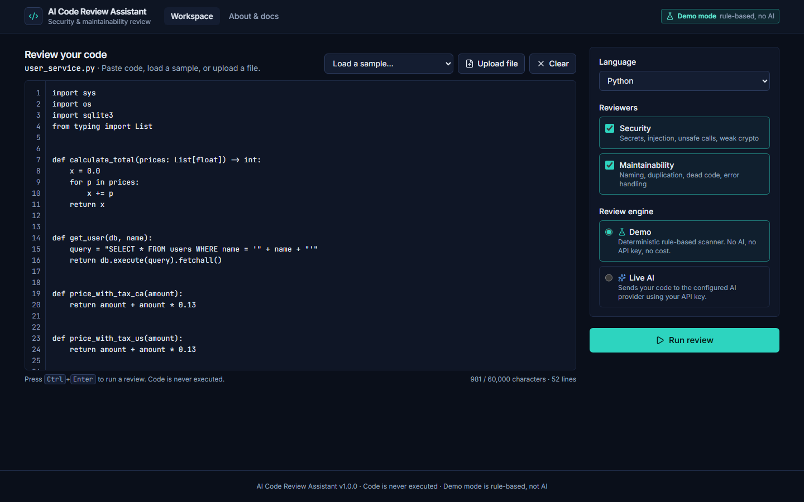
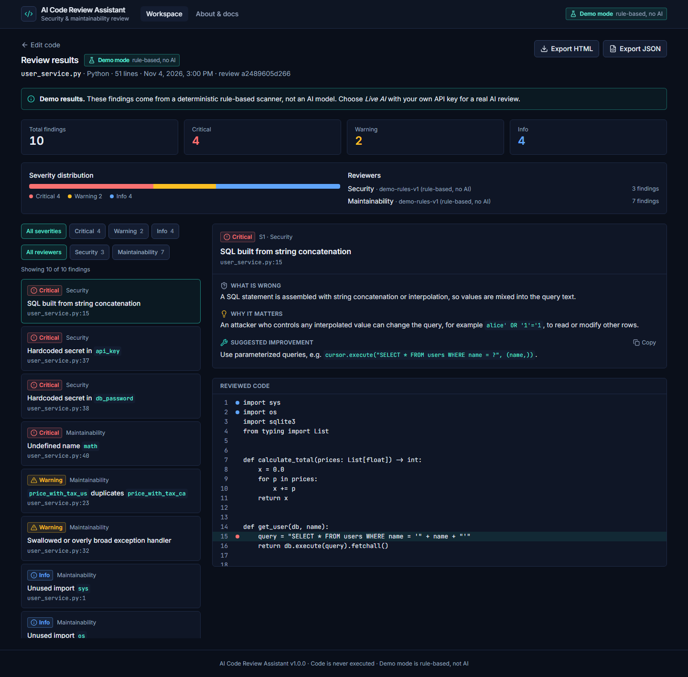
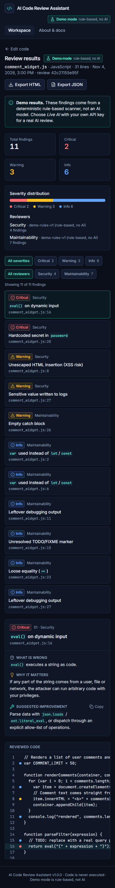
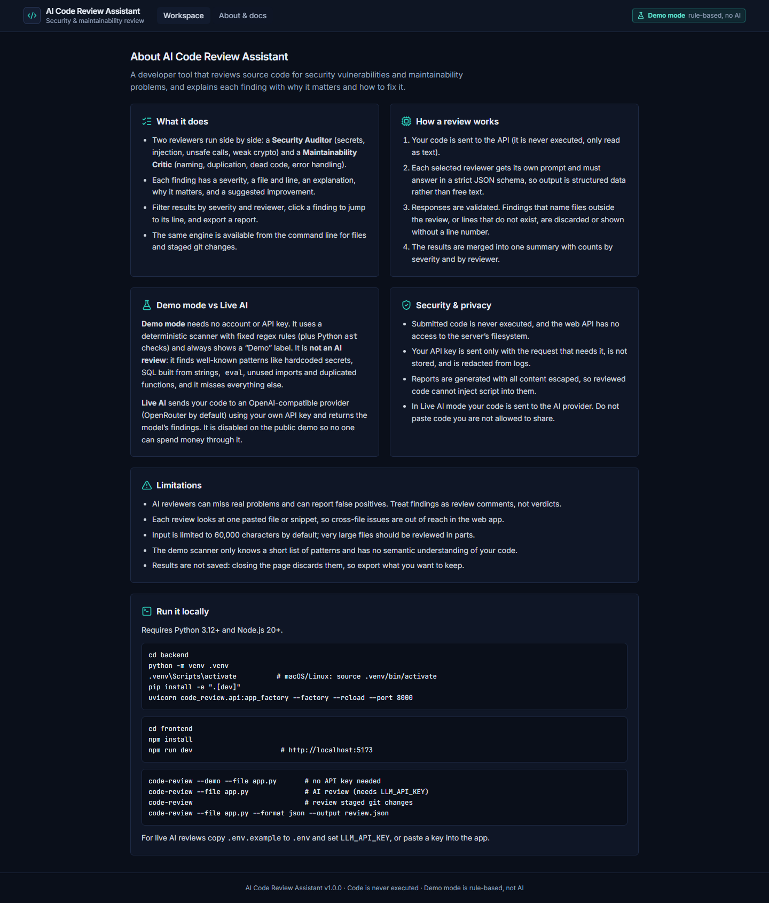

# AI Code Review Assistant

A developer tool that reviews source code for **security vulnerabilities** and **maintainability problems**, then explains every finding: what is wrong, why it matters, and how to fix it. It has a React web interface, a FastAPI backend, and a command-line tool that also reviews staged git changes.

It runs in two modes:

- **Demo mode** (default): a deterministic, rule-based scanner. No API key, no cost, always clearly labeled as *not AI*.
- **Live AI mode**: two AI reviewers (a Security Auditor and a Maintainability Critic) that return structured findings. Needs your own API key for any OpenAI-compatible provider (OpenRouter by default).

The AI reviewers started as my AIP444 coursework (a tool-calling CLI reviewer). This project keeps that agent loop and builds a tested API, web UI, and report generation around it. See [What changed from the assignment](#what-changed-from-the-original-assignment).

| Workspace | Results |
| --- | --- |
|  |  |

<details>
<summary>More screenshots (mobile, About page)</summary>





</details>

## Features

- Paste code, load a bundled sample, or upload a file; choose the language and which reviewers to run.
- Structured findings: title, severity (critical / warning / info), file and line, description, why it matters, suggested fix.
- Results with summary counts, a severity distribution, filters by severity and reviewer, and a code view that marks the lines with findings.
- Export a self-contained **HTML** or **JSON** report.
- CLI: review a file or your staged git changes, in demo or live mode, with HTML or JSON output.
- Typed error handling for empty input, oversized input, missing or invalid API keys, rate limits, network failures, malformed model output and server errors. Messages never contain secrets.
- Accessible, responsive UI: keyboard operable, visible focus, semantic HTML, reduced-motion support, and automated axe-core WCAG A/AA scans of every screen (not a substitute for a manual screen-reader audit).

## Technology

| Area | Stack |
| --- | --- |
| Backend | Python 3.12, FastAPI, Pydantic v2, OpenAI SDK (any OpenAI-compatible provider) |
| Frontend | React 19, TypeScript, Vite, Tailwind CSS v4, lucide-react icons |
| Testing | pytest (+ pytest-asyncio, httpx), Vitest + Testing Library, Playwright |
| Tooling | Ruff, ESLint, `tsc`, GitHub Actions, Docker |

## Architecture

```text
 Browser (React)                    FastAPI                        AI provider
 ┌──────────────┐  POST /api/review ┌──────────────────────┐
 │ Workspace    │ ────────────────► │ api.py   routes,     │
 │ Results      │ ◄──────────────── │          errors,     │
 │ About        │   ReviewResponse  │          rate limit  │
 └──────────────┘                   │ service.py validate, │   chat completions
                                    │          orchestrate │ ───────────────────►  OpenRouter /
                                    │ agents.py reviewer   │ ◄───────────────────  OpenAI-compatible
                                    │          loop, JSON  │   structured JSON
                                    │          validation  │
                                    │ demo.py  rule engine │
                                    │ reports.py HTML/JSON │
                                    └──────────────────────┘
 CLI (cli.py) ───────────────────────► same service / agents, plus read_file + ripgrep tools
```

Key decisions:

- **One engine, two front doors.** The web API and the CLI share the same agents, schemas and report code.
- **Strict structured output.** Reviewers must answer with a JSON schema; replies are validated with Pydantic, retried once if malformed, and findings that cite files or lines that do not exist are discarded or have the line removed.
- **No filesystem tools on the server.** `read_file` and `ripgrep` exist only for the CLI, restricted to the repository root with secret-file and symlink protections. The web API reviews only the pasted text.
- **Demo mode is a different engine**, not canned output, and every response carries `is_demo` so the UI and reports can label it.

More detail is in [docs/learning/02-architecture.md](docs/learning/02-architecture.md).

## Getting started

Requirements: Python 3.12+, Node.js 20+ (22 recommended).

### 1. Backend

```bash
cd backend
python -m venv .venv
source .venv/bin/activate        # Windows: .venv\Scripts\activate
pip install -e ".[dev]"
uvicorn code_review.api:app_factory --factory --reload --port 8000
```

The API is now at <http://127.0.0.1:8000> with interactive docs at `/api/docs`.

### 2. Frontend

```bash
cd frontend
npm install
npm run dev                      # http://localhost:5173 (proxies /api to :8000)
```

To serve the UI from the backend instead, run `npm run build` in `frontend/` and restart the backend: it detects `frontend/dist` automatically.

### Configuration

Copy [.env.example](.env.example) to `backend/.env` (or set real environment variables). Everything is optional; demo mode needs none of it.

| Variable | Default | Purpose |
| --- | --- | --- |
| `LLM_API_KEY` (or `OPENROUTER_API_KEY`) | none | Key for live AI reviews. Alternatively users paste one in the UI. |
| `LLM_BASE_URL` | `https://openrouter.ai/api/v1` | Any OpenAI-compatible endpoint. Server-side only. |
| `REVIEW_MODEL`, `SECURITY_MODEL`, `MAINTAINABILITY_MODEL` | `deepseek/deepseek-v4.1-flash` | Model names. Change them if your provider uses other ids. |
| `ENABLE_LIVE_REVIEW` | `true` | Set `false` for a public demo: the server then never calls an AI provider. |
| `LIVE_RATE_LIMIT_PER_MINUTE` | `6` | Live reviews per client IP per minute. |
| `MAX_CODE_CHARS` | `60000` | Largest reviewable input. |
| `CORS_ORIGINS` | `http://localhost:5173,http://127.0.0.1:5173` | Allowed browser origins in development. |

The default model ids come from the original assignment; check that they exist at your provider before a live run.

## CLI

Install the backend (above), then run `code-review` (or `python -m code_review`) from the project you want to review.

```bash
code-review --demo --file app.py             # rule-based, no key needed
code-review --file app.py                    # AI review of one file
code-review                                  # AI review of `git diff --staged`
code-review --file app.py --reviewers security --format json --output review.json
code-review --file app.py --no-tools         # AI sees only the file, no read_file/ripgrep
```

| Option | Meaning |
| --- | --- |
| `--file PATH` | Review one file instead of the staged changes |
| `--demo` | Use the rule-based demo engine (files only) |
| `--reviewers LIST` | `security`, `maintainability`, or both (default) |
| `--format html\|json` | Report format (default `html`) |
| `--output FILE` | Report path (default `review-YYYYMMDD-HHMMSS.<ext>`) |
| `--no-tools` | Do not let the AI call `read_file` / `ripgrep` |
| `--debug` | Detailed logs on stderr (secrets are redacted) |

Exit code is `0` on success and `1` for any error, with a one-line message on stderr. Live mode needs `LLM_API_KEY`; with AI tools enabled, `rg` ([ripgrep](https://github.com/BurntSushi/ripgrep)) must be on your PATH for the `ripgrep` tool.

## Tests and quality checks

```bash
# Backend (from backend/)
ruff check . && ruff format --check .
pytest -q

# Frontend (from frontend/)
npm run lint && npm run typecheck
npm test                         # Vitest unit + component tests
npm run build
npx playwright install chromium  # once
npm run e2e                      # needs `npm run build` first; starts the backend itself
```

No test calls a paid AI API: the AI client is replaced with a scripted fake, and one suite drives the real OpenAI SDK against a mocked HTTP transport. Last local run: 157 backend tests, 25 frontend tests and 11 Playwright tests (including axe-core accessibility scans) passing; ruff, ESLint and the TypeScript check clean. CI runs the same checks (see [.github/workflows/ci.yml](.github/workflows/ci.yml)).

Regenerate the screenshots from the running app with `npm run screenshots` (in `frontend/`).

## Security considerations

- Submitted code is treated as data and is **never executed**. Prompts tell the models to treat code and tool output as untrusted and ignore instructions inside it.
- The web API has **no filesystem access**. Samples are chosen by id from a fixed allow-list; there is no path parameter.
- CLI tools only read inside the repository root, refuse `.env`, keys, `.git` and symlinks that leave the root, and cap output size and runtime.
- API keys are read from the environment or a request header, never hardcoded, never stored, and scrubbed from logs and error messages.
- The AI provider URL is configured on the server; a request cannot redirect it (no SSRF through the API).
- Reports are generated with every value HTML-escaped plus a strict Content-Security-Policy.
- Limits: input size, request body size, request timeout, per-IP rate limit for live reviews. Responses carry `nosniff`, `X-Frame-Options` and a CSP.
- For a public deployment set `ENABLE_LIVE_REVIEW=false` so nobody can spend your money.

## Deployment

The [Dockerfile](Dockerfile) builds the UI and serves everything from one container with live AI **disabled**, and [render.yaml](render.yaml) describes a free Render web service. I have not deployed it yet, so there is no live URL in this README. Steps: push to GitHub, create a Render account, choose *New > Blueprint*, select the repository, and verify `/api/health`. I could not build the Docker image on my machine (no Docker installed), so treat the image as unverified until the first deploy.

## Known limitations

- AI findings can be wrong or incomplete; they are review comments, not verdicts.
- The web app reviews one pasted file or snippet at a time; no repository-wide analysis.
- Demo mode only knows a short list of regex and Python-`ast` rules.
- No accounts, history or persistence. Results exist only in the browser until exported.
- The rate limiter is in memory and per process; behind a proxy it sees the proxy's address unless configured otherwise.
- Default model ids may need changing for your provider.

## What changed from the original assignment

- Kept: both reviewer prompts and their false-positive rules, the tool loop (`read_file`, `ripgrep`) with its safety checks, strict JSON-schema output with one retry, diff parsing with line verification, and the CLI's staged-diff and `--file` modes.
- Added: richer findings (title, why it matters, suggestion), typed errors, the FastAPI service, the web UI, the demo engine, JSON and HTML report generation, rate limiting, and the test suite.
- Replaced: the third "Judge" model that wrote the final HTML report. Reports are now generated deterministically from validated data, which is cheaper, safer (no model-written HTML to sanitize) and testable. A judge pass that de-duplicates findings across reviewers is on the roadmap.

## Roadmap

- Optional judge/consolidation pass across reviewers.
- Review a GitHub pull request by URL.
- More demo rules and language-aware parsing.
- Saved review history (needs a database and sign-in).
- Streaming progress for long AI reviews.
- SARIF export for code-scanning tools.

## Project layout

```text
backend/code_review/   API, agents, prompts, demo engine, reports, CLI
backend/tests/         pytest suite (fake AI client)
frontend/src/          React app and Vitest tests
frontend/e2e/          Playwright smoke tests and screenshot script
docs/learning/         guided walkthrough of the code
docs/career/           resume bullets, portfolio text, demo script
```
